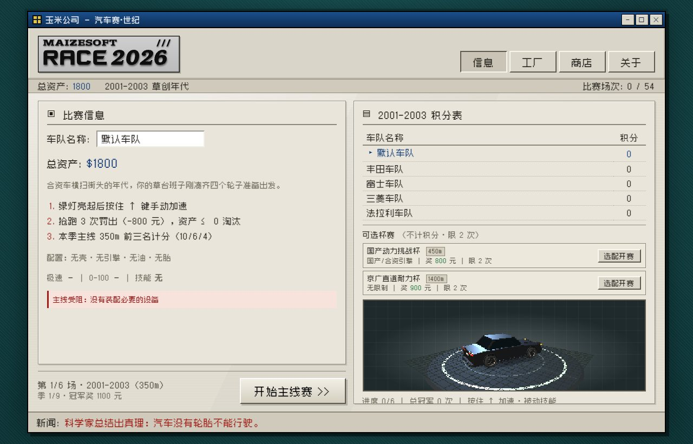
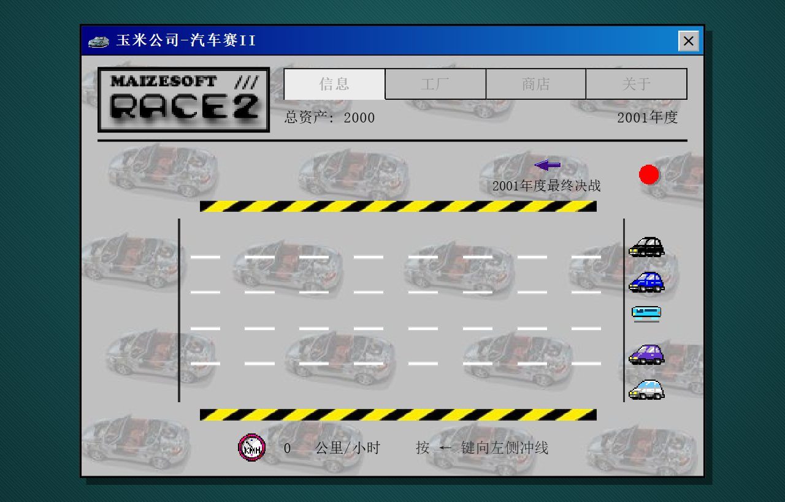

# 汽车赛·世纪 RACE 2026

一个业余时间用 Three.js 写的《汽车赛 II》同人重制。原版《汽车赛 II》是玉米公司 2001 年的作品，这个项目只是凭兴趣和回忆做的非官方版本，难免粗糙，请多包涵。感谢原作者授权使用原版素材。

在线试玩：<https://race2026-9q8.pages.dev/>（桌面和手机浏览器都可以）

玩法很简单：从 2001 年开始经营车队，买车壳、引擎、燃油、轮胎和配件，跑完 9 个赛季 54 场比赛和几届杯赛。比赛是手动加速的，绿灯亮起后按住加速键，抢跑会被罚款。



## 运行

Windows 用户直接到 [Releases](https://github.com/jiimjiim/race2026/releases) 下载 `Race2026.exe`，双击即玩。它依赖系统的 WebView2 运行时，Win10/11 一般已自带。

手机和 Android：直接打开在线版，或下载 Release 里的 `Race2026.apk`。手机建议横屏，比赛时按住右下角的「加速」按钮。

从源码运行：

```
npm install
npm run dev
```

也可以双击 `play.bat`，会自动安装依赖、构建并打开浏览器。

## 操作

- 比赛：绿灯亮起后按住 `↑` 加速（复古模式用 `←` 或 `↑`）
- 界面：鼠标点击

## 构建 exe

```
npm run build:exe
```

产物是 `game/Race2026.exe`，单文件，用系统自带的 .NET Framework 编译器打包。

## 构建 APK

```
npm run build:apk
```

需要 JDK 17+ 和 Android SDK（build-tools 与 platform），产物是 `game/Race2026.apk`。APK 使用本机调试证书签名，仅供侧载安装。

## 开发说明

程序主体（游戏逻辑、界面与比赛流程）由 DeepSeek V4.1 Flash 1017 完成，场景与车辆模型由 Gemini 4 Hydrogen 搭建。

## 版权与素材

- 本项目自行编写的代码与自制素材采用 MIT 许可，见 [LICENSE](LICENSE)。
- 复古模式「BACK TO 2001」中的界面图片与音效来自原版《汽车赛 II》（玉米公司，2001），版权归原作者所有，经原作者授权在本非商业同人项目中使用。这部分**不属于 MIT 许可范围**，请勿单独提取、再分发或商用，详见 [NOTICE.md](NOTICE.md)。
- 字体为 [Zpix 最像素](https://github.com/SolidZORO/zpix-pixel-font)，授权见 `public/fonts/ZPIX-LICENSE.txt`。
- 车名与商标归各自权利人。本项目仅供学习交流，不用于商业用途。
- 存档保存在浏览器 localStorage，换浏览器或清理缓存会丢失。


